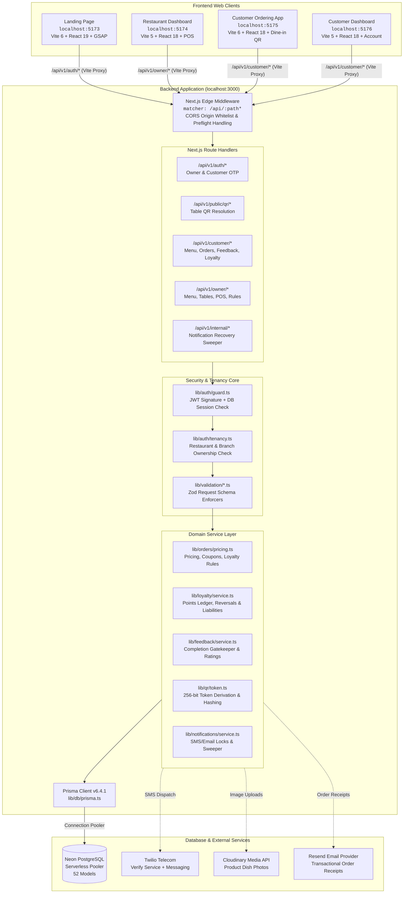
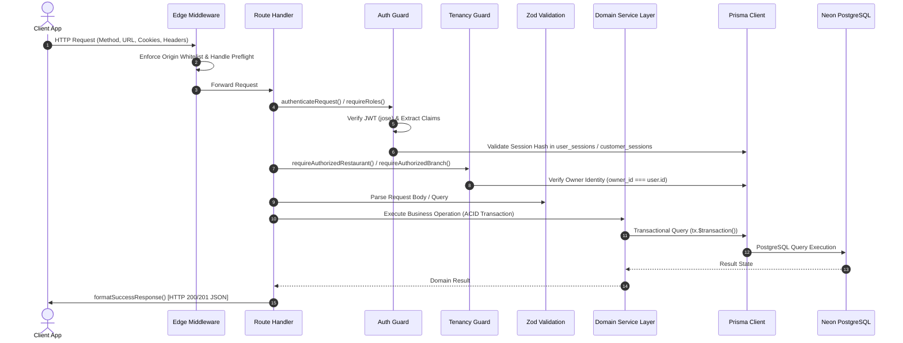
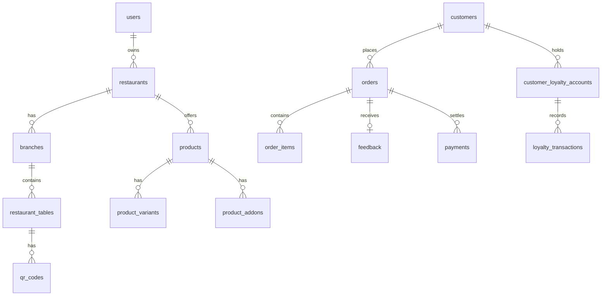

# Restrauque — AI-Native Café & Restaurant Intelligence Platform

> **Comprehensive Technical Documentation & Developer Onboarding Guide**  
> *Authoritative Source Reference for Architecture, APIs, Database Schemas, and Development Workflows.*

---

## Table of Contents

1. [Project Overview](#1-project-overview)
2. [Feature Overview & Implementation Status](#2-feature-overview--implementation-status)
3. [System Architecture](#3-system-architecture)
4. [Repository Structure](#4-repository-structure)
5. [Technology Stack](#5-technology-stack)
6. [Prerequisites](#6-prerequisites)
7. [Environment Configuration](#7-environment-configuration)
8. [Installation & Local Startup](#8-installation--local-startup)
9. [Backend Architecture & Request Lifecycle](#9-backend-architecture--request-lifecycle)
10. [Frontend Architecture](#10-frontend-architecture)
11. [API Reference Summary](#11-api-reference-summary)
12. [Authentication & Authorization](#12-authentication--authorization)
13. [Database Architecture & Entity Relationships](#13-database-architecture--entity-relationships)
14. [Points-Only Loyalty Accounting System](#14-points-only-loyalty-accounting-system)
15. [Core Business Workflows](#15-core-business-workflows)
16. [Testing & Quality Verification](#16-testing--quality-verification)
17. [Troubleshooting Guide](#17-troubleshooting-guide)
18. [Contribution Guide & Code Standards](#18-contribution-guide--code-standards)
19. [Known Limitations & Technical Debt](#19-known-limitations--technical-debt)
20. [Glossary & Onboarding Checklist](#20-glossary--onboarding-checklist)
21. [Supporting Documentation Links](#21-supporting-documentation-links)

---

## 1. Project Overview

### What is Restrauque?
**Restrauque** is an AI-native café and restaurant intelligence platform designed to unify contactless QR dining, live kitchen and floor operations, points-based customer loyalty, verified feedback collection, and restaurant analytics into an integrated multi-tenant software system.

### The Problem It Solves
Traditional restaurants suffer from fragmented tools: one platform for digital menus, another for POS/order taking, disconnected third-party review sites, separate loyalty punch-card software, and clunky hardware terminals. Restrauque replaces this fragmented stack with:
- **Zero-Download Dine-In Experience**: Diners scan a table QR code to view live menus with customizable add-ons/variants, place orders, redeem loyalty points, and review completed meals.
- **Tenant-Isolated Operational Management**: Restaurant owners manage branch profiles, menu items, table QR codes with instant cryptographic rotation, promotional coupons, staff permissions, and real-time POS order pipelines.
- **Points-Only Loyalty Ledger**: A transparent, double-entry points accounting system where diners earn points through dining spend, visits, and reviews, with automatic reversal and liability tracking on order cancellations.

### Primary User Roles
1. **Diners / Customers**: Guests seated at restaurant dining tables who authenticate seamlessly via 6-digit SMS OTP, customize orders, redeem loyalty points, and submit verified dish reviews.
2. **Restaurant Owners & Managers**: Business administrators who oversee branches, curate menus, manage dining tables and QR tokens, track real-time kitchen queues, analyze POS sales, and configure loyalty rules.
3. **Floor Staff & Kitchen Operators**: Restaurant staff who view the live POS kitchen order queue, transition dish statuses (`placed` -> `preparing` -> `ready` -> `served` -> `completed`), and record in-person cash/card/UPI settlements.

---

## 2. Feature Overview & Implementation Status

| Feature / Domain | Description | Current Status | Primary Source Paths |
| :--- | :--- | :--- | :--- |
| **Owner Authentication** | Email & bcrypt password auth, dual-token JWT + session verification, HttpOnly cookies. | **Implemented** | `Backend/app/api/v1/auth/owner/`, `Backend/lib/auth/` |
| **Restaurant Tenancy** | Multi-tenant ownership model with branch isolation and cross-tenant access rejection. | **Implemented** | `Backend/lib/auth/tenancy.ts`, `Backend/app/api/v1/owner/` |
| **Dining Tables & QR** | Table management with 256-bit cryptographically secure QR tokens, rotation, and dynamic branded PNG generation. | **Implemented** | `Backend/lib/qr/`, `Backend/app/api/v1/owner/tables/` |
| **Customer OTP Auth** | 6-digit phone SMS OTP authentication with rate limiting (60s cooldown, 5 attempts) via Twilio Verify, Messaging, or Mock. | **Implemented** | `Backend/lib/auth/otp.ts`, `Backend/lib/auth/otp-provider.ts` |
| **Customer Dine-in Ordering** | Real-time digital menu, add-ons/variants, server pricing preview, and idempotent order placement. | **Implemented** | `Backend/app/api/v1/customer/orders/`, `frontend/customer screen/customer_ordering_side/` |
| **Points-Only Loyalty** | Points accounting ledger: visit/review/spend rewards, min 20 pt redemption, 50% bill cap, cancellation reversals. | **Implemented** | `Backend/lib/loyalty/service.ts`, `Backend/app/api/v1/customer/loyalty/` |
| **Customer Feedback** | 1-5 star dining & dish reviews strictly gated to completed orders, with unique 1-feedback-per-order invariant. | **Implemented** | `Backend/lib/feedback/service.ts`, `Backend/app/api/v1/customer/feedback/` |
| **POS Orders & Sales** | Kitchen queue state transitions, cash/card/UPI payment recording, and duplicate-settlement reporting. | **Implemented** | `Backend/app/api/v1/owner/orders/`, `Backend/lib/dashboard/sales.ts` |
| **Promotional Coupons** | Fixed and percentage discount coupons with minimum spend requirements and max discount limits. | **Implemented** | `Backend/app/api/v1/owner/coupons/`, `Backend/lib/orders/pricing.ts` |
| **Cloudinary Dish Uploads** | Authenticated image upload for menu items with MIME validation and size limits. | **Implemented** | `Backend/app/api/v1/owner/menu/products/upload/`, `Backend/lib/media/` |
| **Transactional Notifications** | SMS/Email order completion alerts and background recovery sweeper with distributed database leases. | **Implemented** | `Backend/lib/notifications/`, `Backend/app/api/v1/internal/` |
| **Reward Catalogue** | Owner endpoints for physical/catalogue rewards. | **Partially Implemented** | `Backend/app/api/v1/owner/loyalty/rewards/` |
| **AI Insights & Copilot** | Database models exist, but live LLM orchestration pipeline is not yet wired to external AI providers. | **Preview / Demo** | `frontend/restaurant dashboard/src/features/insights/`, `Backend/prisma/` |

---

## 3. System Architecture

The platform consists of five independently developed applications communicating over HTTP and JSON APIs:



For complete technical design details, see [System Architecture Guide](./docs/ARCHITECTURE.md).

---

## 4. Repository Structure

```
restrauque/
├── README.md                                  # Root authoritative onboarding documentation
├── docs/                                      # Specialized technical reference documents
│   ├── ARCHITECTURE.md                        # Application diagrams, request lifecycles, and security model
│   ├── API_REFERENCE.md                       # Comprehensive catalog of all 60 API endpoints
│   ├── DATABASE.md                            # Neon PostgreSQL reference, ER diagram, and 52 Prisma models
│   ├── LOCAL_DEVELOPMENT.md                   # Step-by-step setup, port allocations, and startup commands
│   ├── BUSINESS_WORKFLOWS.md                  # User journeys, loyalty accounting rules, and sequence diagrams
│   ├── KNOWN_LIMITATIONS.md                   # Integration audit, partial features, and technical debt
│   ├── TROUBLESHOOTING.md                     # Practical diagnostics and fixes for common errors
│   └── CONTRIBUTING.md                        # Git conventions, PR standards, and feature addition steps
│
├── Backend/                                   # Authoritative Next.js API & Database Engine
│   ├── app/                                   # Next.js App Router
│   │   ├── api/v1/                            # REST API route handlers
│   │   │   ├── auth/                          # Customer OTP & Owner authentication
│   │   │   ├── customer/                      # Menu, orders, feedback, loyalty, and dashboard overview
│   │   │   ├── internal/                      # Background notification recovery sweeper
│   │   │   ├── owner/                         # Tenancy, menu, tables, POS orders, coupons, and rules
│   │   │   └── public/qr/                     # Cryptographic QR token resolution
│   │   ├── feedback/[orderId]/                # Web fallback for customer dining feedback
│   │   └── qr/[token]/                        # Server-rendered QR dine-in experience
│   ├── lib/                                   # Business logic & domain services
│   │   ├── auth/                              # JWT signing, sessions, cookies, OTP providers, tenancy
│   │   ├── db/                                # Prisma database client singleton
│   │   ├── feedback/                          # Review gatekeeper and star rating aggregation
│   │   ├── loyalty/                           # Points ledger, redemption caps, and liability tracking
│   │   ├── notifications/                     # SMS/Email dispatches with distributed database leases
│   │   ├── orders/                            # Pricing engine, coupon calculations, cursor pagination
│   │   ├── qr/                                # 256-bit QR token generation, hashing, and PNG rendering
│   │   └── validation/                        # Zod schemas for request validation
│   ├── middleware.ts                          # Edge CORS whitelist and preflight handler
│   ├── prisma/                                # Database definitions and migrations
│   │   ├── schema.prisma                      # Authoritative schema (52 models)
│   │   └── migrations/                        # SQL migration scripts
│   ├── tests/                                 # 48 Vitest test suites
│   ├── package.json                           # Next.js 15.2, Prisma 6.4, React 19, Zod 3.24
│   └── vitest.config.ts                       # Test runner configuration
│
└── frontend/                                  # Frontend Web Applications
    ├── landing page/                          # Parallax Marketing Portal (Port 5173)
    │   ├── src/pages/                         # Landing, customer login modal, restaurant auth redirect
    │   ├── package.json                       # Vite 6, React 19, GSAP 3.13
    │   └── vite.config.ts                     # Dev server with /api proxy to localhost:3000
    │
    ├── restaurant dashboard/                  # Operations & POS Management Portal (Port 5174)
    │   ├── src/features/                      # Live orders, menu, tables & QR, coupons, loyalty rules
    │   ├── src/services/                      # API client with credentials: 'include'
    │   ├── package.json                       # Vite 5, React 18, React Router 6, Tailwind CSS
    │   └── vite.config.ts                     # Dev server with /api proxy to localhost:3000
    │
    └── customer screen/
        ├── customer_ordering_side/            # Mobile Dine-in QR Experience (Port 5175)
        │   ├── src/features/                  # Mobile login, menu catalog, cart, checkout, order tracker
        │   ├── package.json                   # Vite 6, React 18, Canvas Confetti
        │   └── vite.config.ts                 # Dev server with /api proxy to localhost:3000
        │
        └── customer_dashboard/                # Customer Account & Loyalty Portal (Port 5176)
            ├── src/pages/account/             # Overview, itemized order history, loyalty ledger, reviews
            ├── package.json                   # Vite 5, React 18, React Router 6
            └── vite.config.ts                 # Dev server with /api proxy to localhost:3000
```

---

## 5. Technology Stack

| Technology | Layer / Application | Verified Version | Purpose |
| :--- | :--- | :--- | :--- |
| **Next.js** | Backend API Gateway | `15.2.0` | App Router REST API handlers, Edge Middleware, server routing |
| **Prisma ORM** | Backend Database Client | `6.4.1` | PostgreSQL schema mapping, type-safe queries, migration scripts |
| **PostgreSQL (Neon)**| Primary Database | 16 (Serverless) | ACID transactions, foreign keys, row-level locks, connection pooler |
| **React** | Backend & Frontends | `18.3.1` / `19.0.0` | Declarative component UI across customer and owner applications |
| **Vite** | Frontend Build Tool | `5.4.11` / `6.0.7` | Fast HMR dev server and optimized production bundling |
| **TypeScript** | Universal Language | `5.6.3` / `5.7.3` | End-to-end static typing across backend APIs and frontend apps |
| **Zod** | Backend Validation | `3.24.2` | Runtime payload parsing, type coercion, and error messages |
| **jose** | Authentication | `5.9.6` | Lightweight signed JWT creation, decoding, and signature checks |
| **bcryptjs** | Cryptography | `3.0.2` | Secure password hashing (12 salt rounds) for restaurant owners |
| **QRCode / jsQR** | QR Management | `1.5.4` / `1.4.0` | 256-bit QR token generation, decoding, and dynamic PNG streaming |
| **GSAP & ScrollTrigger**| Landing Page | `3.13.0` | Parallax scroll animations and intro sequence |
| **Lucide React** | Icons | `0.460.0`+ | Accessible SVG icon library across all frontend dashboards |
| **Vitest** | Backend Testing | `3.0.5` | Fast, multi-suite test runner executing in Node.js environment |
| **Cloudinary** | Media Storage | `2.11.0` | Cloud CDN storage for dish photos uploaded by restaurant owners |
| **Twilio SDK / API** | Telecom / SMS | REST API | SMS OTP verification and order completion deep link dispatches |

---

## 6. Prerequisites

Ensure your development machine has the following verified software installed:

```bash
node --version  # Minimum: v18.18.0 (Recommended: v20.x or v22.x LTS)
npm --version   # Minimum: v9.x (Recommended: v10.x)
git --version   # Minimum: v2.30+
```

---

## 7. Environment Configuration

### Backend Setup (`Backend/.env`)
Copy the verified template in `Backend/`:
```bash
cd Backend
cp .env.example .env
```

#### Key Variables & Guidance

| Variable Name | Required? | Exposure | Purpose / Safe Local Guidance |
| :--- | :--- | :--- | :--- |
| `DATABASE_URL` | **Yes** | Server-Only | Neon PostgreSQL connection string (must include `?sslmode=require`). |
| `JWT_SECRET` | **Yes** | Server-Only | Random string (minimum 32 characters) for signing session JWTs. |
| `OTP_SECRET` | Optional | Server-Only | Keyed secret for hashing pending OTP challenges (falls back to `JWT_SECRET`). |
| `NODE_ENV` | **Yes** | Server-Only | `development`, `test`, or `production`. Controls cookie `Secure` flag. |
| `PORT` | Optional | Server-Only | Backend listening port (default: `3000`). |
| `NEXT_PUBLIC_APP_URL`| **Yes** | Public/Client | Root backend URL (default: `http://localhost:3000`). |
| `ALLOWED_ORIGINS` | Optional | Server-Only | Comma-separated list of additional CORS origins allowed by middleware. |
| `SMS_PROVIDER` | **Yes** | Server-Only | Use `"mock"` in local dev for console logs; use `"twilio"` in production. |
| `TWILIO_ACCOUNT_SID` | In Prod | Server-Only | Twilio account SID for SMS delivery. |
| `TWILIO_AUTH_TOKEN` | In Prod | Server-Only | Twilio authentication token. |
| `TWILIO_VERIFY_SERVICE_SID`| In Prod | Server-Only | Preferred Twilio Verify Service SID (handles DLT automatically). |
| `INTERNAL_API_SECRET`| Optional | Server-Only | Secret for triggering background recovery workers (`/api/v1/internal/*`). |
| `CLOUDINARY_CLOUD_NAME`| Optional | Server-Only | Cloudinary account name for dish photo uploads. |

> [!CAUTION]
> Never commit `.env` files or hardcode real API tokens in code. Client-exposed variables (`NEXT_PUBLIC_*` or `VITE_*`) must never contain passwords, private keys, or signing secrets.

For detailed setup instructions, see [Local Development Guide](./docs/LOCAL_DEVELOPMENT.md).

---

## 8. Installation & Local Startup

Run each application in a separate terminal window:

### Terminal 1: Backend API Engine (Port 3000)
```bash
cd Backend
npm install
npx prisma generate
npm run dev
```
*Health verification:* Open `http://localhost:3000/api/v1/health` in your browser.

### Terminal 2: Restaurant Dashboard (Port 5174)
```bash
cd "frontend/restaurant dashboard"
npm install
npm run dev
```

### Terminal 3: Customer Ordering Side (Port 5175)
```bash
cd "frontend/customer screen/customer_ordering_side"
npm install
npm run dev
```

### Terminal 4: Customer Dashboard (Port 5176)
```bash
cd "frontend/customer screen/customer_dashboard"
npm install
npm run dev
```

### Terminal 5: Landing Page (Port 5173)
```bash
cd "frontend/landing page"
npm install
npm run dev
```

---

## 9. Backend Architecture & Request Lifecycle

Every API request follows a 9-step execution pipeline:



---

## 10. Frontend Architecture

| Frontend Application | Port | State Management | Routing Mechanism | API Client Convention |
| :--- | :--- | :--- | :--- | :--- |
| **Landing Page** | `5173` | React State / GSAP context | React Router 7 (`/`, `/login/*`) | Direct `fetch()` with credentials |
| **Restaurant Dashboard** | `5174` | React Context (`AuthContext`, `RestaurantContext`) | React Router 6 (`/dashboard/*`) | `apiClient.ts` wrapper with credentials |
| **Customer Ordering App** | `5175` | Custom Hook & Context (`useAppContext`) | Single Page App / Tab routing | `apiClient.ts` + localStorage table context |
| **Customer Dashboard** | `5176` | React Context (`CustomerAuthContext`) | React Router 6 (`/account/*`) | `apiClient.ts` wrapper with credentials |

---

## 11. API Reference Summary

The platform implements 60 REST endpoints categorized across operational domains:

- **Authentication (`/api/v1/auth/*`)**: Owner registration/login, customer phone OTP request/verification, session validation (`/auth/me`), and logout.
- **Public QR (`/api/v1/public/qr/*`)**: Resolves dining table, branch, and restaurant branding from a 256-bit QR token.
- **Customer Ordering (`/api/v1/customer/*`)**: Menu retrieval, authoritative price preview, idempotent order placement, itemized receipts, and order history with cursor pagination.
- **Customer Feedback & Loyalty (`/api/v1/customer/*`)**: Completed-order feedback submission and multi-restaurant points ledger summaries.
- **Owner Tenancy & Branches (`/api/v1/owner/*`)**: Restaurant profiles, branch onboarding, and tenancy verification.
- **Owner Menu & Cloudinary (`/api/v1/owner/menu/*`)**: Categories, dish items, portion variants, customizable add-ons, and authenticated image uploads.
- **Owner Dining Tables (`/api/v1/owner/tables/*`)**: Table creation, cryptographic QR generation, branded PNG streaming, and atomic token rotation.
- **Owner POS & Sales Analytics (`/api/v1/owner/*`)**: Kitchen order status transitions, payment settlements, gross/net sales, and duplicate-settlement detection.
- **Owner Loyalty Rules & Accounting (`/api/v1/owner/loyalty/*`)**: Points-per-visit, points-per-review, rupee conversion rates, customer ledgers, and cancellation liability recovery.
- **Internal Automation (`/api/v1/internal/*`)**: Distributed lease-locked background notification recovery sweeper.

For complete parameter schemas, request bodies, and error responses, see [API Reference Guide](./docs/API_REFERENCE.md).

---

## 12. Authentication & Authorization

### Dual-Token Security Architecture
1. **Stateless JWT**: Contains user ID, role (`CUSTOMER` or `RESTAURANT_OWNER`), session ID, and an unhashed random session token. Signed via HMAC-SHA256.
2. **Stateful Database Session**: The database stores only the SHA-256 hash of the session token. Revoking a session in PostgreSQL immediately invalidates the JWT.
3. **Cookie Transport**: Cookies are configured with `HttpOnly: true`, `SameSite: 'lax'`, `Path: '/'`, and `Secure: true` in production.
4. **Tenancy Guardrails**: `requireAuthorizedRestaurant()` enforces that the authenticated owner's `user.id` strictly matches the persisted `restaurants.owner_id`. Cross-tenant tampering returns HTTP 403 Forbidden.

---

## 13. Database Architecture & Entity Relationships

The schema is maintained in `Backend/prisma/schema.prisma` and encompasses 52 models:



For model definitions, constraints, and index details, see [Database Reference Guide](./docs/DATABASE.md).

---

## 14. Points-Only Loyalty Accounting System

> [!IMPORTANT]
> **Restrauque loyalty is strictly points-only. There is NO tier system.**  
> Silver, Gold, Platinum, VIP tiers, and tier progress bars do not exist in business logic. Any legacy `tier` columns in database schemas are inert compatibility fields.

### Core Earning Rules
1. **Dining Spend Reward**: Customers earn **1 point per ₹50 of eligible discounted spend** (`SPEND_POINTS_PER_RUPEES = 50`) on completed orders.
2. **Visit Reward**: Customers earn points upon completed restaurant visits (default: **5 points**, `stars_per_visit`).
3. **Review Reward**: Diners receive points upon submitting post-dining reviews (default: **10 points**, `stars_per_review`).

### Checkout Redemption Rules
1. **Minimum Redemption**: 20 points (`MIN_REDEMPTION_POINTS = 20`).
2. **Maximum Bill Discount Cap**: Points can discount at most **50% of the eligible bill** (`MAX_REDEMPTION_DISCOUNT_PERCENTAGE = 0.50`), calculated on the subtotal after promotional coupons.
3. **Conversion Rate**: Configurable per restaurant in `loyalty_programs.redemption_rate` (default: ₹1.00 per point).
4. **Concurrency Safety**: Points redemptions acquire a `FOR UPDATE` row-level lock on the customer's loyalty account inside an ACID database transaction.

### Order Cancellation Reversal & Liability Ledger
1. **Points Refund**: If points were redeemed at checkout, cancelling the order refunds the points immediately to the diner.
2. **Spend Reversal**: If spend points were credited on completion, cancelling the order attempts to reverse them.
3. **Unrecovered Liability**: If the diner already spent those points elsewhere and their current balance is insufficient, their balance is reduced to 0, and the unrecovered difference is recorded in `orders.unrecovered_loyalty_points`.
4. **Recovery**: Owners track outstanding liabilities via `/api/v1/owner/orders/loyalty/liabilities` and recover points when the diner earns fresh balances.

---

## 15. Core Business Workflows

Detailed sequence diagrams and execution flows for major workflows—including Owner Onboarding, Table QR Setup, Customer QR Scan, SMS OTP Login, Idempotent Checkout, Order Completion, Review Submission, and Cancellation Reversals—are documented in the [Business Workflows Guide](./docs/BUSINESS_WORKFLOWS.md).

---

## 16. Testing & Quality Verification

```bash
# Backend Test Suite (48 Vitest suites covering Auth, Tenancy, Pricing, Loyalty, QR)
cd Backend
npm test

# Frontend Typechecks & Production Builds
cd "frontend/landing page" && npm test && npm run build
cd "frontend/restaurant dashboard" && npm run build
cd "frontend/customer screen/customer_ordering_side" && npm test && npm run build
cd "frontend/customer screen/customer_dashboard" && npm test && npm run build
```

---

## 17. Troubleshooting Guide

Common issues, diagnostic commands, and safe fixes:
- **Missing Environment Variables**: Copy `Backend/.env.example` and verify string lengths (`JWT_SECRET` must be >= 32 chars).
- **Neon Database Disconnections**: Ensure `?sslmode=require` is present in `DATABASE_URL` and allow 3-5 seconds for cold-start compute resume.
- **Prisma Client Desynchronization**: Run `npx prisma generate` in `Backend/`.
- **Port Conflicts (`EADDRINUSE`)**: Terminate zombie Node processes on ports 3000, 5173, 5174, 5175, or 5176.
- **CORS Errors**: Route requests through Vite's `/api` proxy or add custom origins to `ALLOWED_ORIGINS` in `Backend/.env`.
- **Cookie Session Loss**: Ensure all client `fetch()` requests pass `{ credentials: 'include' }`.
- **SMS OTP Delivery Failures**: In development, set `SMS_PROVIDER="mock"` to log codes to the backend terminal.

For the complete guide, see [Troubleshooting Guide](./docs/TROUBLESHOOTING.md).

---

## 18. Contribution Guide & Code Standards

- **Conventional Commits**: Format commit messages as `<type>(<scope>): <description>` (`feat`, `fix`, `docs`, `test`, `refactor`).
- **Feature Addition**: Always implement validation schemas (`Backend/lib/validation/`), business logic services (`Backend/lib/`), and automated tests (`Backend/tests/`). Keep route handlers thin.
- **Clean Git Hygiene**: Never commit `.env` files, `node_modules`, or temporary `.vite/deps` cache files.

See [Contribution Guide](./docs/CONTRIBUTING.md) for step-by-step procedures.

---

## 19. Known Limitations & Technical Debt

A complete audit of implemented, partially implemented, preview, and dormant features (such as LLM AI Insights pipelines, online customer payment gateways, and reward catalogue claims) is provided in [Known Limitations](./docs/KNOWN_LIMITATIONS.md).

---

## 20. Glossary & Onboarding Checklist

### Glossary
- **Edge Middleware**: Next.js Edge proxy verifying CORS origins and intercepting `OPTIONS` preflight requests before route execution.
- **Tenancy Boundary**: Architectural pattern ensuring data queries are strictly scoped to the authenticated owner's `restaurants.id`.
- **Idempotency Key**: Cryptographic UUID passed during order creation to ensure network retries never double-charge or create duplicate orders.
- **Points Ledger**: Append-only audit table (`loyalty_transactions`) recording every credit and debit of customer points.
- **Distributed Lease Lock**: Database-backed mutex using `notifications.read_at` to serialize background workers and prevent duplicate SMS delivery.

### Day 1 Onboarding Checklist
- [ ] Clone repository and checkout `Backend` branch.
- [ ] Verify Node.js (`v20.x`+) and npm (`v10.x`+).
- [ ] Copy `Backend/.env.example` to `Backend/.env` and set `SMS_PROVIDER="mock"`.
- [ ] Run `npm install` and `npx prisma generate` in `Backend/`.
- [ ] Start backend server (`npm run dev`) and verify `http://localhost:3000/api/v1/health`.
- [ ] Start frontend applications on ports 5173, 5174, 5175, and 5176.
- [ ] Run `npm test` in `Backend/` to verify baseline test suite.

---

## 21. Supporting Documentation Links

- [System Architecture Guide](./docs/ARCHITECTURE.md)
- [Complete API Reference (60 Endpoints)](./docs/API_REFERENCE.md)
- [Database Architecture & Prisma Schema](./docs/DATABASE.md)
- [Local Development & Startup Guide](./docs/LOCAL_DEVELOPMENT.md)
- [Core Business Workflows & Loyalty Mechanics](./docs/BUSINESS_WORKFLOWS.md)
- [Known Limitations & Technical Debt](./docs/KNOWN_LIMITATIONS.md)
- [Troubleshooting & Diagnostics](./docs/TROUBLESHOOTING.md)
- [Developer Contribution Standards](./docs/CONTRIBUTING.md)
