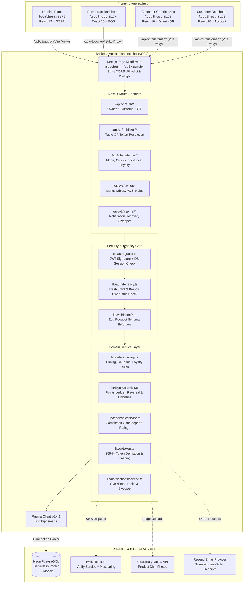
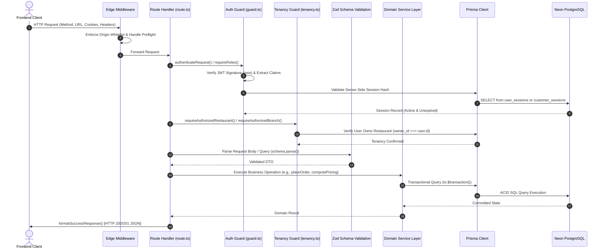

# System Architecture & Technical Design

This document details the software architecture, application relationships, communication protocols, request lifecycles, and security models of the Restrauque platform.

---

## 1. High-Level Architecture Overview

Restrauque is designed as a distributed, multi-application platform with an authoritative central Next.js API and database gateway, communicating with four specialized frontend web clients.



---

## 2. Application Directory Inventory & Roles

| Application | Path | Technology Stack | Primary Responsibilities |
| :--- | :--- | :--- | :--- |
| **Backend API Gateway** | `Backend/` | Next.js 15.2, React 19, TypeScript, Prisma 6.4, Zod, Vitest | Authoritative REST API handlers, tenancy isolation, transactional ordering engine, loyalty ledger, QR cryptography, and database migrations. |
| **Parallax Landing Page** | `frontend/landing page/` | Vite 6, React 19, GSAP 3.13, ScrollTrigger, Lucide | High-performance public brand website with parallax hero animations, restaurant login redirection, and customer phone auth modal. |
| **Restaurant Dashboard** | `frontend/restaurant dashboard/` | Vite 5, React 18, React Router 6, Lucide, Tailwind CSS | Management portal for owners and staff: live POS order queue, payment settlement, menu categories/products, dining tables & QR codes, coupons, feedback analytics, and loyalty rule setup. |
| **Customer Ordering App** | `frontend/customer screen/customer_ordering_side/` | Vite 6, React 18, Context API, Canvas Confetti | Zero-download, mobile-optimized dine-in ordering web app accessed via table QR scan. Includes SMS OTP auth, digital menu with add-ons/variants, real-time cart, promotional coupons, loyalty point redemption, and post-dining review submission. |
| **Customer Dashboard** | `frontend/customer screen/customer_dashboard/` | Vite 5, React 18, React Router 6, Lucide | Customer self-service portal: multi-restaurant loyalty point balances, lifetime earning records, order history with itemized receipts, and review submission for completed orders. |

---

## 3. Communication and Networking

### 3.1 Development Reverse Proxies
During local development, all four frontend applications run their own Vite development servers. To eliminate browser Cross-Origin Resource Sharing (CORS) complications and cookie blocking across differing ports, each frontend Vite configuration proxies calls matching `/api` to the backend:

```ts
// Example: frontend/restaurant dashboard/vite.config.ts
export default defineConfig({
  server: {
    port: 5174,
    proxy: {
      '/api': {
        target: 'http://localhost:3000',
        changeOrigin: true,
      },
    },
  },
});
```

### 3.2 Production CORS Edge Middleware
When frontends communicate directly with a deployed backend origin, `Backend/middleware.ts` enforces a strict origin whitelist:

- **Allowed Origins**: `http://localhost:5173`, `http://localhost:5174`, `http://localhost:5175`, `http://localhost:5176`, plus origins configured in `process.env.ALLOWED_ORIGINS` and `process.env.NEXT_PUBLIC_APP_URL`.
- **Credential Protection**: The middleware explicitly sets `Access-Control-Allow-Credentials: true` and mirrors the validated incoming `Origin` header. It **never** uses the wildcard `*` with credentials.
- **OPTIONS Handling**: Preflight `OPTIONS` requests receive an immediate `204 No Content` response with caching headers (`Access-Control-Max-Age: 86400`), bypassing business logic and database overhead.

---

## 4. Authoritative Backend Request Lifecycle

Every API request in `Backend/app/api/` follows a strict, layered 9-step execution pipeline:



### 4.1 Tenancy & Branch Isolation Rules
1. **Never Trust Client Tenancy**: Endpoints never trust client-supplied owner IDs, restaurant IDs, or branch IDs without database-backed ownership validation.
2. **Strict Restaurant Scope**: Every owner query resolves the authenticated owner's `user.id` from the secure session and joins against `restaurants.owner_id`.
3. **Cross-Tenant Access Rejection**: If an authenticated owner requests a resource (menu item, order, dining table, branch) belonging to another restaurant, `requireAuthorizedRestaurant()` immediately throws `ForbiddenError` (HTTP 403).

---

## 5. Security & Session Architecture

### 5.1 Dual-Token Authentication Model
Restrauque uses a defense-in-depth authentication model combining stateless signed JWTs with stateful database-persisted session hashes:

1. **JWT Header & Payload**: Signed using HMAC-SHA256 with `JWT_SECRET`. Contains `userId`, `role` (`CUSTOMER` or `RESTAURANT_OWNER`), `sessionId`, and an unhashed cryptographically random `sessionToken`.
2. **Server-Side Session Record**: Stored in `user_sessions` (for restaurant owners) or `customer_sessions` (for diners). Stores `session_token_hash` (`crypto.createHash('sha256').update(sessionToken).digest('hex')`).
3. **Revocation & Verification**: On every authenticated request, `lib/auth/guard.ts` extracts the JWT, validates its cryptographic signature, computes the SHA-256 hash of `sessionToken`, and looks up the active session in PostgreSQL. If the session was revoked or expired, the request is immediately rejected.
4. **Cookie Security**: Auth cookies (`restrauque_session`) are issued with:
   - `HttpOnly: true` (inaccessible to malicious client-side JavaScript / XSS)
   - `SameSite: 'lax'`
   - `Secure: true` in production (`NODE_ENV === 'production'`)
   - `Path: '/'`

---

## 6. Frontend Architectural Conventions

All frontend clients adhere to clean architectural standards:

1. **Contracts-First DTOs**: Frontend types (e.g., `src/services/contracts/types.ts` or `src/types/domain.ts`) mirror backend schemas and response wrappers.
2. **Service Layer Isolation**: Components never invoke `fetch()` directly. All HTTP communication is encapsulated in dedicated service modules (e.g., `menuService.ts`, `orderService.ts`, `loyaltyService.ts`).
3. **Session Restoration**: When a user opens any frontend application, the auth context dispatches a lightweight session verification call (`/api/v1/auth/me`) with `credentials: 'include'` to restore the logged-in user profile and prevent unnecessary logins.
4. **Optimistic UI with Fallbacks**: Critical user interactions (such as updating cart quantities or toggling item categories) update UI state immediately, rolling back gracefully if the backend responds with a validation error.
