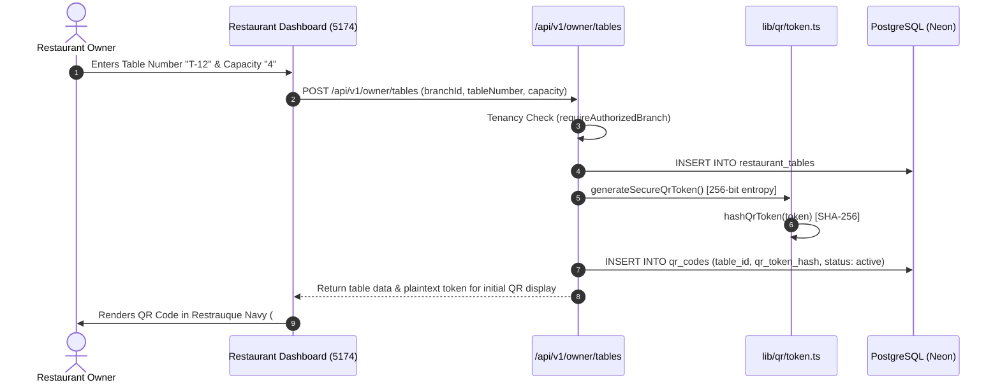
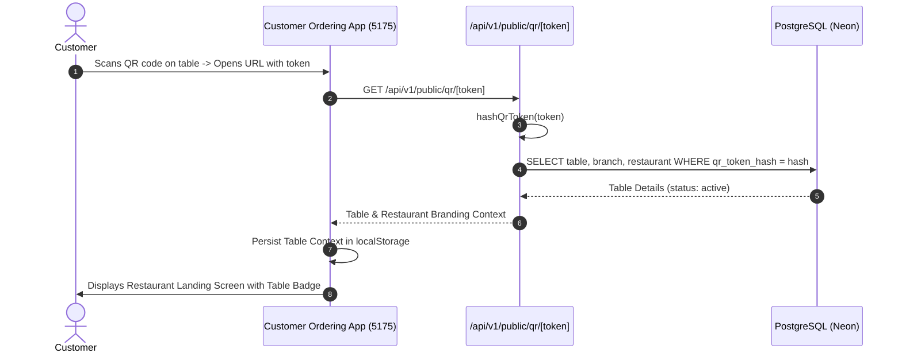
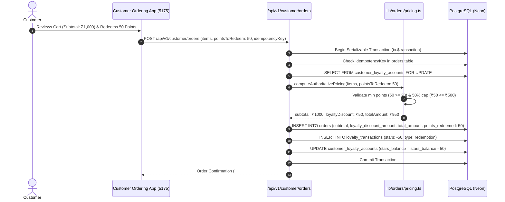

# Core Business Workflows & Execution Mechanics

This document details the critical business workflows implemented across the Restrauque platform, explaining both domain business rules and the exact source code execution paths.

---

## 1. Restaurant Owner Registration & Tenancy Setup

```mermaid
sequenceDiagram
    autonumber
    actor Owner as Restaurant Owner
    participant UI as Restaurant Dashboard (5174)
    participant API as /api/v1/auth/owner/register
    participant Tenancy as lib/auth/tenancy.ts
    participant DB as PostgreSQL (Neon)

    Owner->>UI: Enters Email, Password, Name, Restaurant & Branch Details
    UI->>API: POST /api/v1/auth/owner/register
    API->>API: Validate Inputs (Zod registerSchema)
    API->>API: Hash Password with bcryptjs (12 salt rounds)
    API->>DB: Transactionally create users, restaurants, branches
    DB-->>API: Created IDs
    API->>API: Generate Session Token & Signed JWT (jose)
    API->>DB: INSERT into user_sessions (session_token_hash)
    API-->>UI: Set-Cookie: restrauque_session; Secure; HttpOnly
    UI->>Owner: Redirect to /dashboard/overview
```

---

## 2. Table Creation & Cryptographic QR Code Generation



### QR Token Security Rules
1. **Plaintext Never Stored**: The database only stores `qr_token_hash`. Plaintext tokens are returned only upon initial creation or rotation.
2. **Atomic Rotation**: When an owner rotates a QR code (`POST /api/v1/owner/tables/[tableId]/qr/rotate`), the backend acquires a row-level lock on `restaurant_tables`, revokes all previous `qr_codes` for that table, and inserts a fresh active token.

---

## 3. Customer QR Scan, Resolution & Context Preservation



---

## 4. Customer Phone OTP Authentication

```mermaid
sequenceDiagram
    autonumber
    actor Diner as Customer
    participant UI as Customer Ordering App (5175)
    participant OTPReq as /api/v1/auth/customer/otp/request
    participant OTPVer as /api/v1/auth/customer/otp/verify
    participant Provider as lib/auth/otp-provider.ts (Twilio / Mock)
    participant DB as PostgreSQL (Neon)

    Diner->>UI: Enters 10-digit Phone Number
    UI->>OTPReq: POST /api/v1/auth/customer/otp/request
    OTPReq->>OTPReq: Rate-limit check (60-sec cooldown, 5 max attempts)
    OTPReq->>Provider: requestOtp(phone)
    Provider-->>Diner: Delivers 6-digit SMS OTP
    Diner->>UI: Enters 6-digit Code
    UI->>OTPVer: POST /api/v1/auth/customer/otp/verify
    OTPVer->>Provider: verifyOtp(phone, code)
    Provider-->>OTPVer: Approved
    OTPVer->>DB: Upsert customers record
    OTPVer->>DB: INSERT customer_sessions
    OTPVer-->>UI: Set-Cookie: restrauque_session; HttpOnly
    UI->>Diner: Session Established; Returns to Dining Experience
```

---

## 5. Dine-in Checkout & Points-Only Loyalty Redemption

Restrauque implements a **points-only loyalty system without tiers**.

### Business Rules for Redemption
1. **Minimum Redemption**: 20 points (`MIN_REDEMPTION_POINTS = 20`).
2. **Bill Discount Cap**: Points can cover at most **50% of the eligible bill** (`MAX_REDEMPTION_DISCOUNT_PERCENTAGE = 0.50`), calculated on the subtotal *after* promotional coupon discounts.
3. **Conversion Rate**: Configured per restaurant in `loyalty_programs.redemption_rate` (default: ₹1.00 per point).
4. **Row-Level Locking**: When points are redeemed, the customer's loyalty account is locked (`SELECT ... FOR UPDATE`) inside an ACID database transaction to prevent double-spending.



---

## 6. Order Completion & Spend Loyalty Awarding

When kitchen staff or floor managers mark an order as `completed` via the POS queue:

1. **Status Transition**: `orders.status` is updated to `completed` and `completed_at` is stamped.
2. **Spend Points Calculation**: The customer earns **1 point per ₹50 of eligible discounted spend** (`SPEND_POINTS_PER_RUPEES = 50`).
3. **Double-Entry Ledger Credit**: A signed transaction record is inserted into `loyalty_transactions` with `stars: +N` and `transaction_type: 'visit_reward'`.
4. **SMS Notification Dispatch**: An automated SMS notification is queued in `notifications` and dispatched via Twilio with a deep link to the post-dining feedback screen (`/feedback/[orderId]`).

---

## 7. Post-Dining Feedback & Review Loyalty Reward

1. **Gatekeeper Validation**: Customer feedback is restricted exclusively to `completed` orders. In-progress or cancelled orders reject review attempts.
2. **Single-Submission Invariant**: The database enforces `unique_feedback_order_id`. Second review attempts return HTTP 409 Conflict.
3. **Review Points Awarding**: Submitting feedback immediately credits the diner's loyalty account with `stars_per_review` (default: **10 points**), recorded in `loyalty_transactions`.

---

## 8. Order Cancellation, Ledger Reversal & Unrecovered Liability

When an order is cancelled:

1. **Redeemed Points Restoration**: If points were redeemed at checkout, they are refunded immediately back to the customer (`stars_balance = stars_balance + pointsRedeemed`).
2. **Spend Points Reversal**: If spend points were previously awarded, the system attempts to deduct them from the customer's balance.
3. **Unrecovered Liability Handling**: If the customer already spent those points elsewhere and their current balance is insufficient, the balance is deducted down to 0, and the unrecovered difference is recorded in `orders.unrecovered_loyalty_points`.
4. **Owner Visibility**: Owners can audit outstanding liabilities via `/api/v1/owner/orders/loyalty/liabilities` and trigger automated recovery via `/api/v1/owner/orders/[orderId]/loyalty/recover` when the customer earns fresh points.
