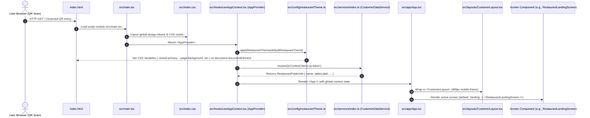
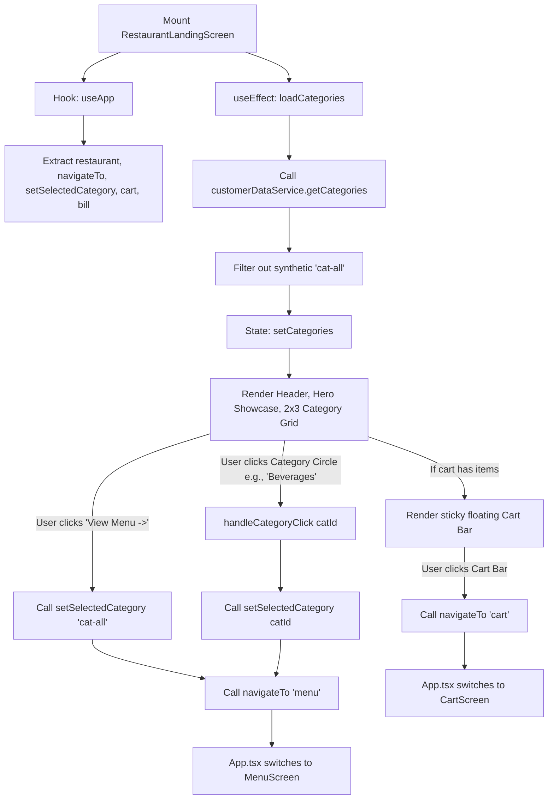
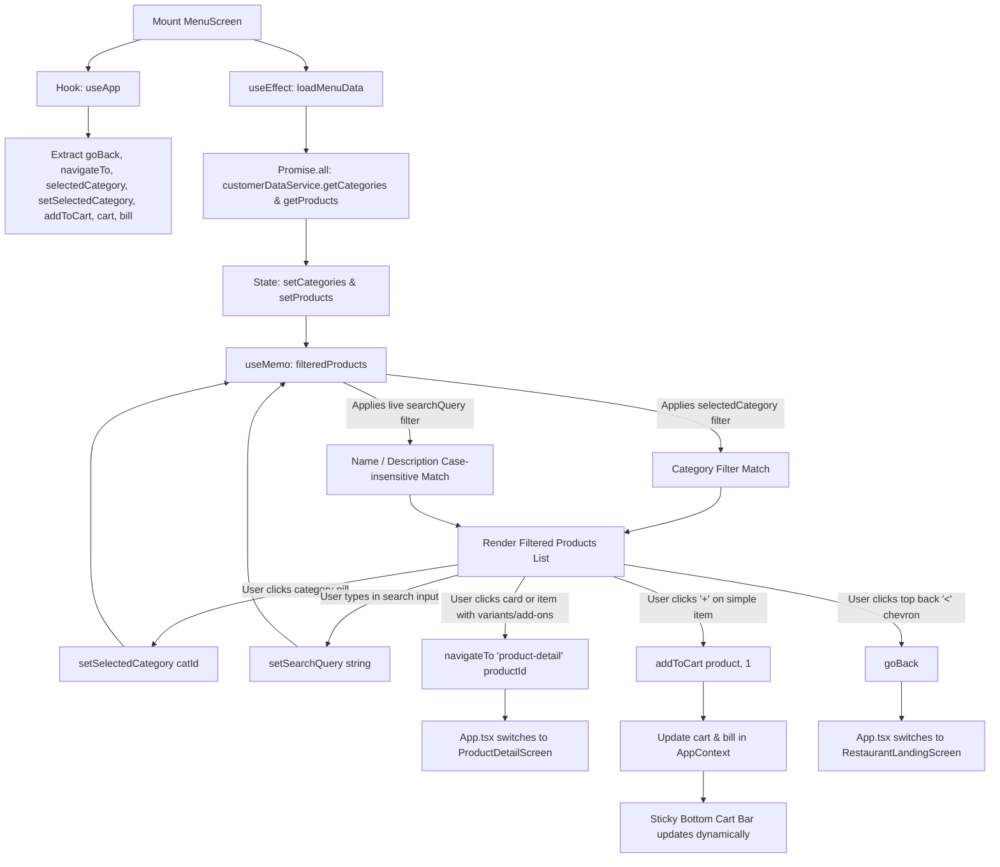
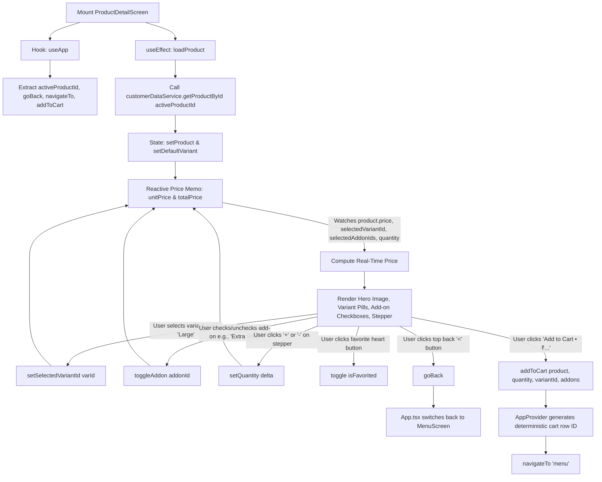
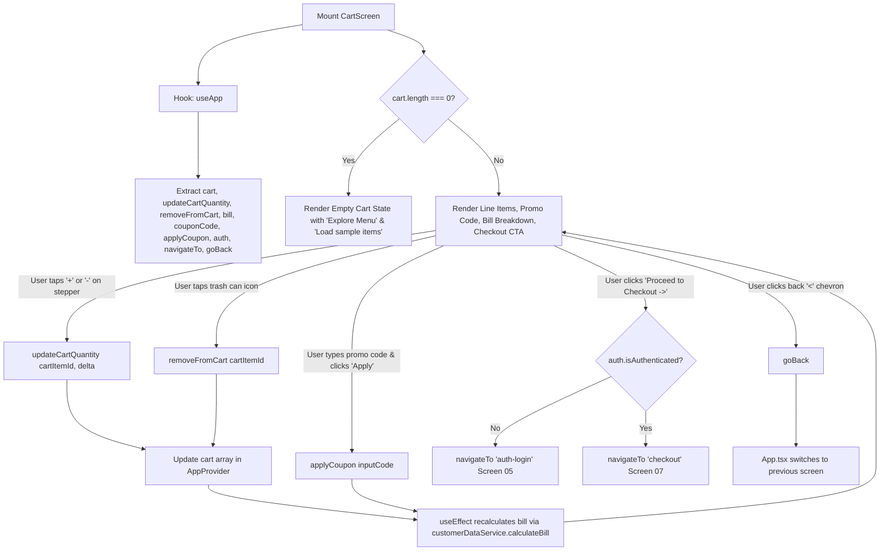
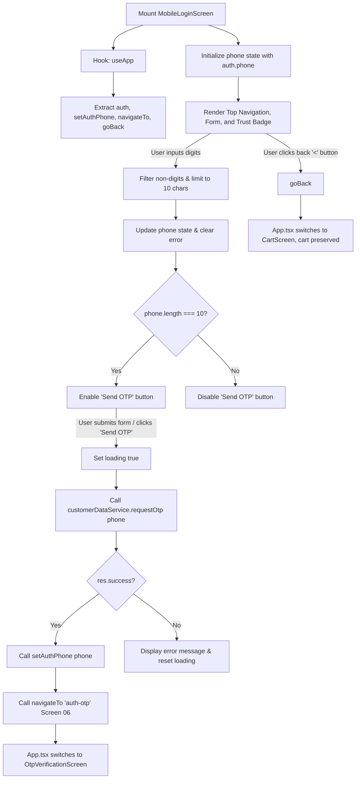
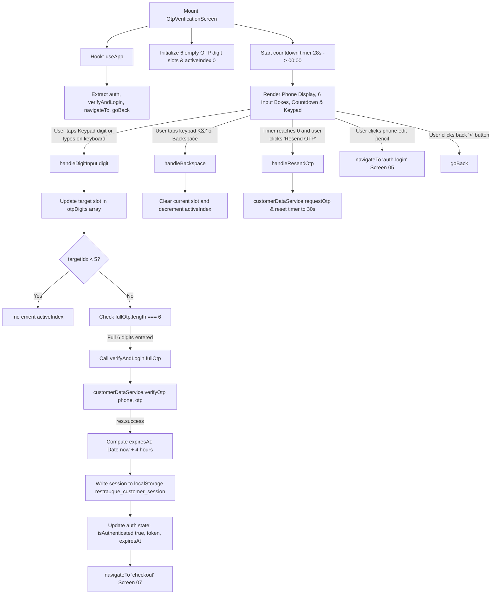
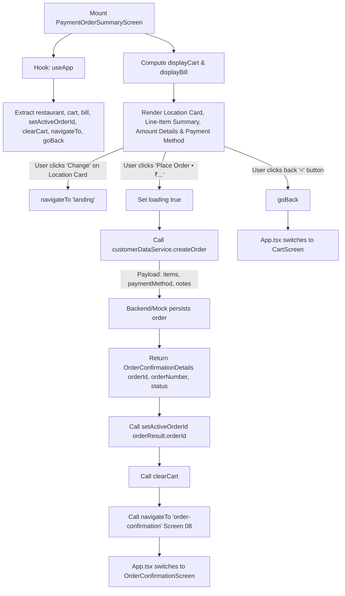
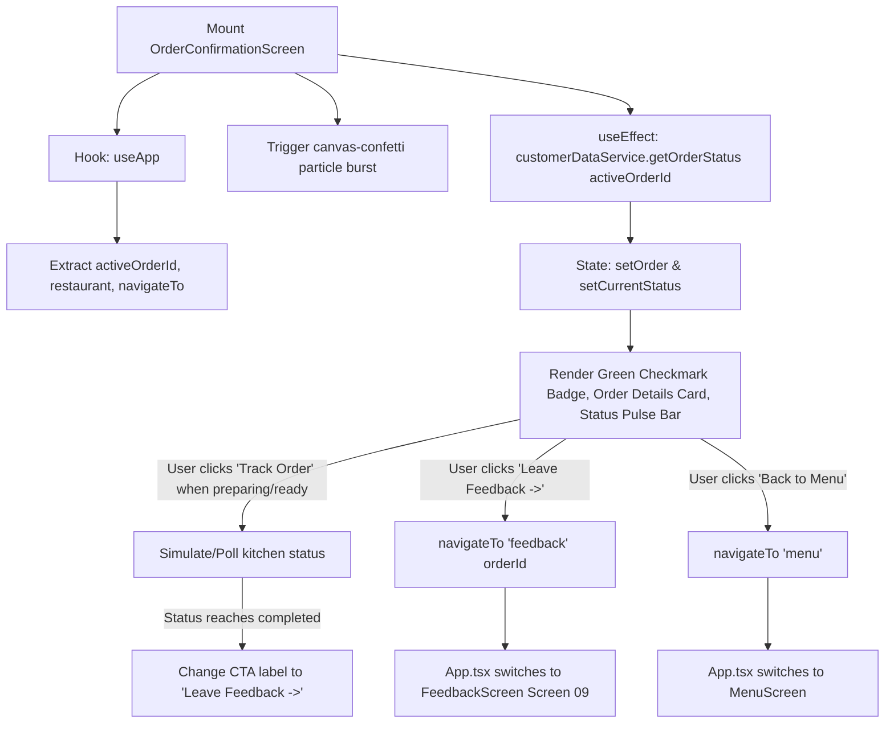
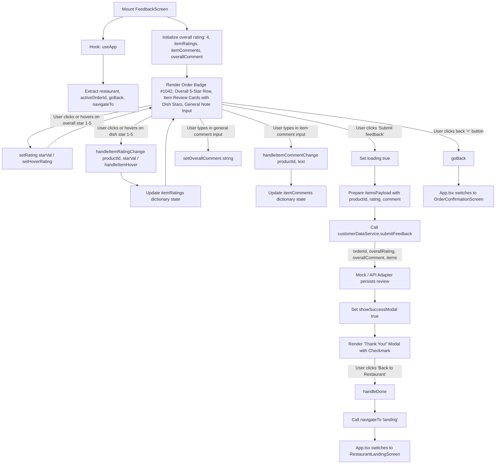

# Restrauque Customer Ordering — Execution & Data Flow Architecture

This document tracks the end-to-end execution path, call hierarchies, file travel patterns, and lifecycle flows of the customer-facing ordering application.

---

## 1. System Entry Point & Bootstrapping Sequence



### Detailed Bootstrapping Steps:
1. **`index.html`**:
   - Sets mobile viewport meta tags (`maximum-scale=1.0, user-scalable=no`).
   - Pre-connects and imports Google Fonts (**Inter** font weights 400–800).
   - Injects `<div id="root"></div>` and executes `/src/main.tsx`.

2. **`src/main.tsx`**:
   - Calls `ReactDOM.createRoot(document.getElementById('root'))`.
   - Wraps root in `<React.StrictMode>` and `<AppProvider>`.

3. **`src/hooks/useAppContext.tsx` (`AppProvider`)**:
   - Initial state initialization:
     - `currentScreen`: `'landing'`
     - `screenHistory`: `['landing']`
     - `selectedCategory`: `'cat-all'`
     - `cart`: `[]`
     - `auth`: `{ phone: '', isAuthenticated: false }`
   - `useEffect` (on mount):
     - Calls `applyRestaurantTheme(defaultRestaurantTheme)` from `src/config/restaurantTheme.ts`.
     - Calls `customerDataService.resolveQrContext(...)` to fetch restaurant name and table number (`NBC - Engineering College`, `Table F18`).
     - Updates `restaurant` state via `setRestaurant()`.

---

## 2. Dynamic Service Layer & Data Traversal

Components **never** import mock fixtures or query raw backend URLs directly. All data access flows through a unified abstraction:

```
[UI Screen Component]
       │
       ▼ (calls method)
[src/services/CustomerDataService.ts] (Interface)
       │
       ▼ (instantiated by src/services/index.ts)
   ┌───┴────────────────────────┐
   │ Check VITE_DATA_MODE       │
   ▼                            ▼
'mock'                        'api'
[MockDataService.ts]       [ApiDataService.ts]
   │                            │
   ▼                            ▼
[src/mocks/*.mock.ts]      [FastAPI / Neon Backend (/api/v1)]
```

### Execution Flow:
1. `src/services/index.ts` reads `import.meta.env.VITE_DATA_MODE`.
2. If `mock` (default): Instantiates `MockDataService`, serving isolated fixtures from `src/mocks/`.
3. If `api`: Instantiates `ApiDataService`, issuing HTTP calls with consistent DTO mapping.

---

## 3. Screen 01: Restaurant Landing Execution Flow

### File: `src/features/restaurant/RestaurantLandingScreen.tsx`



### Function Call Hierarchy:
- `RestaurantLandingScreen`
  - `useApp()`
    - accesses `restaurant`, `navigateTo`, `setSelectedCategory`, `cart`, `bill`
  - `useEffect(() => { loadCategories(); }, [])`
    - calls `customerDataService.getCategories()`
    - calls `setCategories(list.filter(c => c.id !== 'cat-all'))`
  - `handleCategoryClick(categoryId)`
    - calls `setSelectedCategory(categoryId)`
    - calls `navigateTo('menu')`
      - `navigateTo(screen)` in `useAppContext.tsx`:
        - `setScreenHistory(prev => [...prev, screen])`
        - `setCurrentScreen(screen)`
        - `window.scrollTo({ top: 0, behavior: 'smooth' })`
  - `hero-cta-btn.onClick`
    - calls `setSelectedCategory('cat-all')`
    - calls `navigateTo('menu')`

---

## 4. Screen 02: Menu & Category Browsing Execution Flow

### File: `src/features/menu/MenuScreen.tsx`



### Function Call Hierarchy & Parameter Flow:
- `MenuScreen`
  - `useApp()`: extracts `selectedCategory`, `setSelectedCategory`, `addToCart`, `cart`, `bill`, `goBack`, `navigateTo`.
  - `useEffect(() => { loadMenuData(); }, [])`
    - triggers concurrent calls:
      - `customerDataService.getCategories()` -> returns `Category[]`
      - `customerDataService.getProducts()` -> returns `Product[]`
    - updates local state `setCategories()` and `setProducts()`.
  - `useMemo(() => { ... }, [products, selectedCategory, searchQuery])`
    - computes `filteredProducts`: checks `categoryId === selectedCategory` (or `'cat-all'`) and matches `name` / `description` against `searchQuery`.
  - `handleProductClick(product)`
    - calls `navigateTo('product-detail', { productId: product.id })`.
  - `handleAddButtonClick(e, product)`
    - calls `e.stopPropagation()`.
    - checks if product has variants or add-ons; if so, opens `product-detail`.
    - otherwise calls `addToCart(product, 1)` -> recalculates bill via `calculateBill()`.
  - `header.back-button.onClick`
    - calls `goBack()` -> returns to previous screen in `screenHistory`.

---

## 5. Screen 03: Product Details & Customization Execution Flow

### File: `src/features/product-detail/ProductDetailScreen.tsx`



### Function Call Hierarchy & Parameter Flow:
- `ProductDetailScreen`
  - `useApp()`: accesses `activeProductId`, `goBack`, `navigateTo`, `addToCart`.
  - `useEffect(() => { loadProduct(); }, [activeProductId])`
    - calls `customerDataService.getProductById(activeProductId || 'prod-iced-latte')`.
    - sets `selectedVariantId` to the default variant (`var.isDefault`).
  - `useMemo(() => { ... }, [product, selectedVariantId, selectedAddonIds, quantity])`
    - computes `unitPrice = product.price + variantDelta + addonsDelta`.
    - computes `totalPrice = unitPrice * quantity`.
  - `toggleAddon(addonId)`
    - toggles presence in `selectedAddonIds` array.
  - `handleAddToCart()`
    - calls `addToCart(product, quantity, selectedVariantId, selectedAddonIds)`.
    - `addToCart` in `useAppContext.tsx`:
      - creates unique cart key: `${productId}-${variantId}-${addonIds.sort().join('_')}`.
      - merges identical items by incrementing quantity or pushes new row to `cart`.
      - recalculates bill through `customerDataService.calculateBill()`.
    - calls `navigateTo('menu')` (or `cart`).

---

## 6. Screen 04: Cart & Bill Summary Execution Flow

### File: `src/features/cart/CartScreen.tsx`



### Function Call Hierarchy & Parameter Flow:
- `CartScreen`
  - `useApp()`: accesses `cart`, `updateCartQuantity`, `removeFromCart`, `addToCart`, `bill`, `couponCode`, `applyCoupon`, `auth`, `navigateTo`, `goBack`.
  - `updateCartQuantity(cartItemId, delta)`
    - in `useAppContext.tsx`: map over `cart`; updates `quantity` and `totalPrice`; filters out items where `quantity <= 0`.
    - triggers `useEffect([cart, couponCode])` calling `customerDataService.calculateBill(cart, couponCode)`.
  - `removeFromCart(cartItemId)`
    - in `useAppContext.tsx`: filters `cart` to remove matching `cartItemId`.
  - `handleApplyCoupon()`
    - calls `applyCoupon(code)`.
    - updates `couponCode` in `AppContext` and displays validation feedback.
  - `handleProceedToCheckout()`
    - verifies `cart.length > 0`.
    - checks `auth.isAuthenticated`: if true -> `navigateTo('checkout')`, else -> `navigateTo('auth-login')` (Screen 05).
  - `header.back-button.onClick`
    - calls `goBack()` -> pops `screenHistory` and returns to menu.

---

## 7. Screen 05: Mobile Login Execution Flow

### File: `src/features/auth/MobileLoginScreen.tsx`



### Function Call Hierarchy & Parameter Flow:
- `MobileLoginScreen`
  - `useApp()`: accesses `auth`, `setAuthPhone`, `navigateTo`, `goBack`.
  - `handlePhoneChange(e)`:
    - strips all non-numeric characters: `e.target.value.replace(/\D/g, '').slice(0, 10)`.
    - updates local state `setPhone()`.
  - `handleSendOtp(e)`:
    - validates length (`phone.length === 10`).
    - calls `customerDataService.requestOtp(phone)`.
    - on success: calls `setAuthPhone(phone)` in `useAppContext.tsx` and `navigateTo('auth-otp')`.
  - `login-back-btn.onClick`:
    - calls `goBack()` -> returns to Cart (or caller screen) with full cart and order state intact.

---

## 8. White-Label Reusability & Multi-Tenant Data Flow

The entire frontend is 100% decoupled from individual restaurant data:
1. **Dynamic Theme Engine**: Brand colors, background, fonts, radii are applied at runtime via CSS variables through `applyRestaurantTheme()` in `src/config/restaurantTheme.ts`.
2. **Metadata Injection**: Restaurant name, branch, table number, and hero imagery are fetched dynamically via `customerDataService.resolveQrContext(qrToken)` and stored in `AppContext`.
3. **Menu Independence**: Categories, dishes, variants, add-ons, prices, and availability are completely domain-driven and fetched dynamically without hardcoding.

---

## 8. Screen 06: OTP Verification & Session Persistence Execution Flow

### File: `src/features/auth/OtpVerificationScreen.tsx`



### Function Call Hierarchy & Parameter Flow:
- `OtpVerificationScreen`
  - `useApp()`: accesses `auth`, `verifyAndLogin`, `navigateTo`, `goBack`.
  - `formattedPhone`: formats 10-digit number into international format (`+91 98765 43210`).
  - `handleDigitInput(digit)`:
    - writes digit into `otpDigits[activeIndex]`.
    - advances `activeIndex` from 0 to 5.
    - on 6th digit: calls `verifyAndLogin(fullOtp)`.
  - `verifyAndLogin(otp)` in `useAppContext.tsx`:
    - calls `customerDataService.verifyOtp(phone, otp)`.
    - on success: calculates `expiresAt = Date.now() + 4 * 60 * 60 * 1000` (4-hour dining window).
    - persists to `localStorage.setItem('restrauque_customer_session', ...)`.
    - updates `auth` state (`isAuthenticated: true`).
    - user **does not need to log in again** across subsequent visits or order submissions until expiration.
  - `phone-display-row.onClick`:
    - calls `navigateTo('auth-login')` to change the phone number.
  - `otp-back-btn.onClick`:
    - calls `goBack()` -> returns to previous screen preserving cart contents.

---

## 9. White-Label Reusability & Multi-Tenant Data Flow

The entire frontend is 100% decoupled from individual restaurant data:
1. **Dynamic Theme Engine**: Brand colors, background, fonts, radii are applied at runtime via CSS variables through `applyRestaurantTheme()` in `src/config/restaurantTheme.ts`.
2. **Metadata Injection**: Restaurant name, branch, table number, and hero imagery are fetched dynamically via `customerDataService.resolveQrContext(qrToken)` and stored in `AppContext`.
3. **Menu Independence**: Categories, dishes, variants, add-ons, prices, and availability are completely domain-driven and fetched dynamically without hardcoding.

---

## 9. Screen 07: Payment & Order Summary Execution Flow

### File: `src/features/checkout/PaymentOrderSummaryScreen.tsx`



### Function Call Hierarchy & Parameter Flow:
- `PaymentOrderSummaryScreen`
  - `useApp()`: accesses `restaurant`, `cart`, `bill`, `setActiveOrderId`, `clearCart`, `navigateTo`, `goBack`.
  - `displayCart` & `displayBill`:
    - binds dynamically to `cart` and `bill`.
    - provides fallback fixtures if directly previewing checkout.
  - `handlePlaceOrder()`:
    - calls `customerDataService.createOrder({ items: displayCart, paymentMethod: 'Pay at Restaurant (Cash / Card / UPI)' })`.
    - on response:
      - `setActiveOrderId(orderResult.orderId)` saves public identifier in `AppContext`.
      - `clearCart()` resets active cart items.
      - `navigateTo('order-confirmation')` transitions to Screen 08.
  - `location-change-btn.onClick`:
    - calls `navigateTo('landing')` to re-orient table or restaurant context.
  - `header.back-button.onClick`:
    - calls `goBack()` -> returns to Cart (Screen 04).

---

## 10. White-Label Reusability & Multi-Tenant Data Flow

The entire frontend is 100% decoupled from individual restaurant data:
1. **Dynamic Theme Engine**: Brand colors, background, fonts, radii are applied at runtime via CSS variables through `applyRestaurantTheme()` in `src/config/restaurantTheme.ts`.
2. **Metadata Injection**: Restaurant name, branch, table number, and hero imagery are fetched dynamically via `customerDataService.resolveQrContext(qrToken)` and stored in `AppContext`.
3. **Menu Independence**: Categories, dishes, variants, add-ons, prices, and availability are completely domain-driven and fetched dynamically without hardcoding.

---

## 10. Screen 08: Order Confirmation & Live Tracking Execution Flow

### File: `src/features/orders/OrderConfirmationScreen.tsx`



### Function Call Hierarchy & Parameter Flow:
- `OrderConfirmationScreen`
  - `useApp()`: accesses `activeOrderId`, `restaurant`, `navigateTo`.
  - `useEffect(() => { confetti(...); }, [])`:
    - fires multi-colored particle celebration on screen mount.
  - `useEffect(() => { loadOrder(); }, [activeOrderId])`:
    - calls `customerDataService.getOrderStatus(activeOrderId)`.
    - sets customer-safe `orderNumber` (`#NBC1234`), `tableLabel` (`F18`), and formatted timestamp (`12 Dec 2024, 1:24 PM`).
  - `handleTrackOrFeedback()`:
    - if `currentStatus === 'completed'`: invokes `navigateTo('feedback', { orderId })`.
    - otherwise: advances kitchen status toward completed state.
  - `back-to-menu-btn.onClick`:
    - calls `navigateTo('menu')` -> allows seamless re-ordering without repeating authentication.

---

## 11. Screen 09: Post-Completion Customer Feedback Execution Flow

### File: `src/features/feedback/FeedbackScreen.tsx`



### Function Call Hierarchy & Parameter Flow:
- `FeedbackScreen`
  - `useApp()`: accesses `restaurant`, `activeOrderId`, `goBack`, `navigateTo`.
  - `rating`, `setRating`: tracks 1–5 integer overall star score (defaults to 4 stars matching mockup).
  - `hoverRating`, `setHoverRating`: tracks mouse hover state for smooth interactive overall star preview.
  - `itemRatings`, `setItemRatings`: dictionary tracking 1–5 star scores per dish (`Record<string, number>`).
  - `itemHoverRatings`, `setItemHoverRatings`: dictionary tracking hover states per dish (`Record<string, number | null>`).
  - `handleItemRatingChange(productId, starVal)`:
    - updates `itemRatings[productId]` when customer taps or clicks on any dish star.
  - `handleItemHover(productId, starVal)`:
    - provides real-time hover feedback on dish stars.
  - `handleItemCommentChange(productId, text)`:
    - updates `itemComments[productId]` with the user's specific dish review.
  - `handleSubmitFeedback()`:
    - iterates through ordered items, assembling `{ productId, rating, comment }` objects.
    - calls `customerDataService.submitFeedback({ orderId, overallRating, overallComment, items })`.
    - on resolution: sets `showSuccessModal(true)`.
  - `handleDone()`:
    - hides modal and calls `navigateTo('landing')`, returning the user cleanly to the restaurant home screen with their session intact.
  - `back-button.onClick`:
    - calls `goBack()` -> returns to Screen 08 (Order Confirmation).

---

## 12. White-Label Reusability & Multi-Tenant Data Flow

The entire frontend is 100% decoupled from individual restaurant data:
1. **Dynamic Theme Engine**: Brand colors, background, fonts, radii are applied at runtime via CSS variables through `applyRestaurantTheme()` in `src/config/restaurantTheme.ts`.
2. **Metadata Injection**: Restaurant name, branch, table number, and hero imagery are fetched dynamically via `customerDataService.resolveQrContext(qrToken)` and stored in `AppContext`.
3. **Menu Independence**: Categories, dishes, variants, add-ons, prices, and availability are completely domain-driven and fetched dynamically without hardcoding.

---

## 13. State Management & Navigation Flow

The application uses a lightweight, robust centralized context (`AppProvider`) that avoids route-desynchronization issues in QR scanner webviews:

```text
src/app/App.tsx (Observes currentScreen)
    ├── 'landing'            --> <RestaurantLandingScreen />   (Screen 01)
    ├── 'menu'               --> <MenuScreen />                (Screen 02)
    ├── 'product-detail'     --> <ProductDetailScreen />       (Screen 03)
    ├── 'cart'               --> <CartScreen />                (Screen 04)
    ├── 'auth-login'         --> <MobileLoginScreen />         (Screen 05)
    ├── 'auth-otp'           --> <OtpVerificationScreen />     (Screen 06)
    ├── 'checkout'           --> <PaymentOrderSummaryScreen /> (Screen 07)
    ├── 'order-confirmation' --> <OrderConfirmationScreen />   (Screen 08)
    └── 'feedback'           --> <FeedbackScreen />            (Screen 09)
```

### Back Navigation:
- Screens with `<` chevron call `goBack()`:
  - Pops the last entry from `screenHistory`.
  - Sets `currentScreen` to the previous history item.
  - Preserves user input, cart items, selected table, and authentication state throughout the journey.


